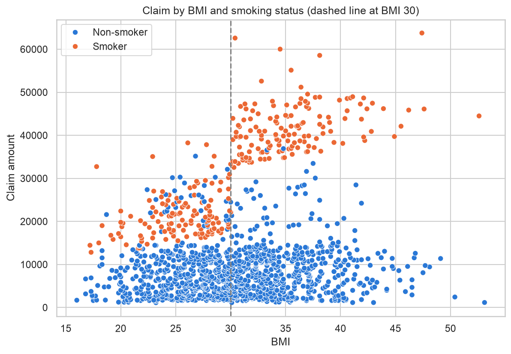

# Health Insurance Claim Cost Forecasting

What drives members' health insurance claim costs, and how accurately can an insurer forecast them? An end-to-end data science project using SQL, statistics, machine learning and Tableau, built around one business goal: helping a health insurer budget for future claims and target prevention programs where they help most.

[](https://public.tableau.com/views/Insurance_Dashboard_17916830318640/ClaimCostForecasting)

[View the interactive dashboard on Tableau Public](https://public.tableau.com/views/Insurance_Dashboard_17916830318640/ClaimCostForecasting)

## Executive summary

- Smoking combined with obesity drives the highest claim costs. Smokers with a BMI of 30 or more are 11% of members but 34% of all claim costs, and their typical claim is more than 5 times a non-smoker's.
- Obesity raises costs mainly for smokers. For non-smokers, a BMI of 30 or more makes little difference. This interaction was found through regression diagnostics and is the key to an accurate forecast.
- The final forecasting model (gradient boosting), tested on members it had never seen, is off by about 3,700 per member on average, 55% less error than a flat estimate (about 8,200). A simpler, explainable linear model comes within 4% to 9% of it.
- Recommendation: plan claim costs by member group with the forecast, and focus prevention programs (quit-smoking, weight management) on smokers with obesity, starting with a pilot that measures whether costs actually fall.

## Business problem

A health insurer has to set money aside for the claims its members will make, and it wants to keep those costs down where it can. To do that, it needs to know what drives claim costs and how much each group of members is likely to cost.

Under the US Affordable Care Act, individual-market premiums cannot depend on health status (such as BMI or blood pressure). So this project does not price individual premiums. It forecasts claim costs to support three decisions:

1. Budgeting: how much to plan for future claims, and from which member groups.
2. Overall premium level: setting prices from expected costs across all members.
3. Prevention: which members a program like quit-smoking support would help most.

Success criterion: the forecast must be clearly more accurate than a flat estimate that gives everyone the same value, measured as the average error in dollars (MAE).

## Data

| | |
|---|---|
| Source | [github.com/Onurbltc/InsuranceData](https://github.com/Onurbltc/InsuranceData) (`insurance.csv`) |
| Size | 1,340 members; 1,332 after removing 8 rows with missing values |
| Columns | age, gender, BMI, blood pressure, diabetic, children, smoker, region, claim amount |

- The source is undocumented, and several patterns suggest the data may be synthetic: diabetes affects 47.9% of members, claims jump sharply at exactly BMI 30, and men are aged 18 to 50 while women are 25 to 60. Results describe this dataset, not real-world insurance.
- Claim units are undocumented; amounts are treated as dollars.
- The raw file is sorted by claim amount, so rows were shuffled before splitting into training and test data.

Details: [data quality summary](reports/findings/01_data_quality_summary.md), [data dictionary](docs/data_dictionary.md).

## Key findings

### 1. Smoking and obesity drive costs together, not separately



Smokers' claims split into two groups, and BMI 30 is the dividing line. Non-smokers show no such jump.

| Median claim | BMI under 30 | BMI 30 or more |
|---|---|---|
| Non-smokers | 6,770 | 8,117 |
| Smokers | 20,167 | 40,904 |

A multiple regression confirmed the pattern while holding age, region, blood pressure and the other variables constant: being a smoker with a BMI of 30 or more adds about 17,750 on top of the smoking effect (95% CI 16,200 to 19,300). For non-smokers, BMI 30+ is not significant. A first regression without this interaction left clear patterns in its errors: it under-forecast smokers with obesity by about 6,500 on average and over-forecast other smokers by about 7,400. Adding the interaction removed both.

Other factors, holding the rest constant: blood pressure (+137 per point) and children (+694 per child) are associated with higher claims, the northeast has higher claims than other regions, and age, gender and diabetes show no evidence of an association. ([EDA summary](reports/findings/02_eda_summary.md), [statistical analysis summary](reports/findings/03_statistical_analysis_summary.md))

### 2. A small group accounts for a third of all claim costs

| Group | Share of members | Share of claim costs |
|---|---|---|
| Non-smokers, BMI under 30 | 38% | 23% |
| Non-smokers, BMI 30+ | 42% | 28% |
| Smokers, BMI under 30 | 10% | 16% |
| Smokers, BMI 30+ | 11% | 34% |

Percentages are rounded, so each column adds up to 101%. Smokers with obesity are the clearest target for prevention: about 1 in 9 members, responsible for about a third of the money paid out.

### 3. The forecast halves the error of a flat estimate

| Approach | Average error per member (test set) |
|---|---|
| Flat estimate (median for everyone) | 8,183 |
| Linear regression with the smoking × obesity interaction | 4,083 |
| Gradient boosting (final model) | 3,697 |

Five models were compared with 5-fold cross-validation, and gradient boosting was chosen before the test set was used. It had the lowest error in every fold, and the test set confirmed it. Tree models found the smoking × obesity pattern on their own. The linear model needed it built in: without the interaction, its error rises by about 840. With it, the explainable model comes within 4% to 9% of the best one, a reasonable choice when forecasts must be explained line by line. ([modeling summary](reports/findings/04_modeling_summary.md))

### 4. Where the forecast falls short

12 of 267 test members cost more than 10,000 above their forecast, 9 of them non-smokers. Nothing in the data explains them. Closing this gap needs more information, such as health history, rather than a more complex algorithm.

On fairness, removing gender changes the error by only 7 per member, so it can be left out. BMI and blood pressure are health status, so in the ACA individual market the model supports planning, not individual pricing.

## Recommendations

1. Plan claim costs by member group using the forecast.
2. Focus prevention programs on smokers with obesity, starting with a pilot and a comparison group to measure real savings.
3. Keep smoking status accurate and up to date; it is the strongest factor and a permitted pricing factor.
4. Collect fuller health history, where legal and consented, to explain unexpected high-cost members.
5. Leave gender out of the model, and keep health status out of individual premiums.

Evidence and confidence for each: [recommendations](reports/findings/05_recommendations.md).

## Limitations

- One dataset of 1,332 members with an undocumented source that may be synthetic. Results would need to be confirmed on real member data.
- The findings are associations. They do not show that smoking or obesity cause higher claims, or that prevention programs would lower them; that needs a pilot with a comparison group.
- The forecast gives one estimate per member with a typical error of about 3,700, not a range for each member.
- A small group of high-cost members is not explained by the available variables.
- Hyperparameter tuning was not done; the default models already beat the flat estimate by a wide margin.

## Approach

| Step | What was done | Where |
|---|---|---|
| 1. Business understanding and setup | Problem framing, scripted download with checksum, DuckDB database | [src/data/](src/data/), [sql/01_load/](sql/01_load/) |
| 2. Data profiling and quality | Missing values, ranges, row order, cleaning rules (SQL) | [sql/02_profiling/](sql/02_profiling/), [summary](reports/findings/01_data_quality_summary.md) |
| 3. Exploratory data analysis | Claim distribution, drivers, interactions, hypotheses | [02_eda.ipynb](notebooks/02_eda.ipynb), [sql/03_analysis/](sql/03_analysis/) |
| 4. Statistical analysis | Multiple regression, diagnostics, robust standard errors, log and gamma alternatives | [03_statistical_analysis.ipynb](notebooks/03_statistical_analysis.ipynb) |
| 5. Predictive modeling | Baseline, five models, cross-validation, test evaluation, error analysis, permutation importance, fairness | [04_modeling.ipynb](notebooks/04_modeling.ipynb), [src/models/](src/models/) |
| 6. Dashboard | One-page Tableau dashboard for a non-technical audience | [Tableau Public](https://public.tableau.com/views/Insurance_Dashboard_17916830318640/ClaimCostForecasting), [tableau/](tableau/) |
| 7. Recommendations | Evidence-backed recommendations and documentation | [recommendations](reports/findings/05_recommendations.md) |

Tools: Python · SQL (DuckDB) · pandas · statsmodels · scikit-learn · matplotlib/seaborn · Tableau

Decisions and their reasons are recorded in the [project log](docs/project_log.md); the full methodology is in [docs/methodology.md](docs/methodology.md).

## How to reproduce

Requires Python 3.13+ and the [DuckDB CLI](https://duckdb.org/docs/installation/).

```bash
# 1. Create a virtual environment (kept outside the project folder) and install packages
python3 -m venv ~/.virtualenvs/insurance-claims
source ~/.virtualenvs/insurance-claims/bin/activate
pip install -r requirements.txt        # or requirements-lock.txt for the exact versions used

# 2. Download the raw data (prints a SHA-256 checksum)
python -m src.data.download_data

# 3. Build the DuckDB database: raw table (1,340 rows) and cleaned table (1,332 rows)
duckdb data/processed/insurance.duckdb \
  -c ".read sql/01_load/load_raw.sql" \
  -c ".read sql/01_load/02_clean_data.sql"

# 4. Run the notebooks in order (02 EDA, 03 statistical analysis, 04 modeling)
jupyter nbconvert --to notebook --execute --inplace notebooks/02_eda.ipynb notebooks/03_statistical_analysis.ipynb notebooks/04_modeling.ipynb

# 5. Rebuild the Tableau data file (the model results file is written by notebook 04)
duckdb data/processed/insurance.duckdb -c ".read sql/03_analysis/07_tableau_export.sql"
```

On macOS with a python.org Python, if the download fails with `CERTIFICATE_VERIFY_FAILED`, run `Install Certificates.command` from the `/Applications/Python 3.x/` folder once.

## Repository structure

```
├── data/
│   ├── raw/                Original CSV (not committed)
│   └── processed/          DuckDB database and Tableau files (not committed)
├── sql/
│   ├── 01_load/            Load and clean the raw data
│   ├── 02_profiling/       Data profiling and quality checks
│   └── 03_analysis/        Segment analysis and Tableau exports
├── notebooks/              EDA, statistical analysis, modeling
├── src/
│   ├── data/               Download script
│   └── models/             Model input preparation
├── tableau/                Tableau workbook
├── reports/
│   ├── figures/            Charts used in this README
│   └── findings/           Written findings for each step and the recommendations
└── docs/                   Methodology, data dictionary, project log
```
