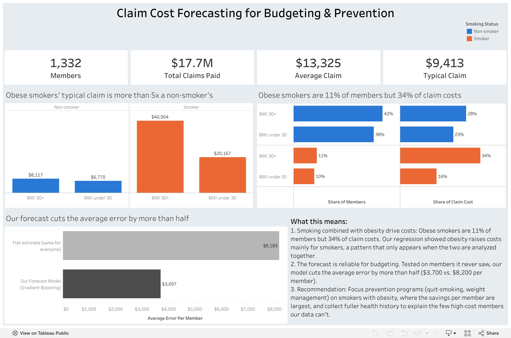

# Health Insurance Claim Analysis and Prediction

An end-to-end data science project. It uses SQL, statistics, machine learning and Tableau to understand which personal and health characteristics are associated with higher health insurance claims, and to predict an individual's claim amount.

> **Status:** Step 7 (Recommendations and Documentation) is next. Findings are added only after the analysis has actually been done.

---

## Business Problem

An insurance pricing team has to decide how much to charge each person for coverage. To do that, they look at a person's information to estimate how much that person is likely to claim: whether they are healthy or unhealthy, whether they smoke, their age, and so on. People who are likely to claim more are charged a higher price, so that the insurer doesn't lose money if something bad happens.

This project identifies which characteristics are associated with higher claims and builds a model that predicts how much a person is likely to claim.

**Success criterion:** the model must predict claims clearly more accurately than a simple baseline that predicts the average claim for everyone. Accuracy is measured as the average error in dollars (MAE). The exact target will be set after data profiling (Step 2), once typical claim amounts are known.

This project asks:

1. **Which characteristics are associated with higher claims?** Candidates include age, BMI, blood pressure, diabetes, smoking, number of children, gender and region.
2. **How large are those effects** when the other factors are held constant?
3. **How accurately can we predict** an individual's claim amount, and is a complex model worth it compared with a simple, explainable one?

## Data

| File | Rows | Columns |
|------|------|---------|
| `insurance.csv` | ~1,340 | `Id`, `age`, `gender`, `bmi`, `bloodpressure`, `diabetic`, `children`, `smoker`, `region`, `claim` |

- **Source:** [github.com/Onurbltc/InsuranceData](https://github.com/Onurbltc/InsuranceData)
- **Provenance:** The repository doesn't document where the data originally came from, or whether it is real or synthetic. All results describe this dataset only and shouldn't be read as facts about real-world insurance.
- **Download:** run `python -m src.data.download_data`. The script prints a SHA-256 checksum for verification.

## Dashboard

[](https://public.tableau.com/views/Insurance_Dashboard_17916830318640/ClaimCostForecasting)

[View the interactive dashboard on Tableau Public](https://public.tableau.com/views/Insurance_Dashboard_17916830318640/ClaimCostForecasting)

## Approach

| Step | Description | Main tools |
|------|-------------|------------|
| 1 | Business understanding and data setup | Python, DuckDB |
| 2 | Data profiling and quality assessment | SQL |
| 3 | Exploratory data analysis | pandas, matplotlib/seaborn, SQL |
| 4 | Statistical analysis | SciPy, statsmodels |
| 5 | Predictive modeling and interpretation | scikit-learn |
| 6 | Stakeholder dashboard | Tableau |
| 7 | Recommendations and documentation | |

Details for each step are in [docs/methodology.md](docs/methodology.md).

## Technical Stack

Python 3.14 · DuckDB (SQL) · pandas · SciPy · statsmodels · scikit-learn · matplotlib/seaborn · Tableau

## Repository Structure

```
├── README.md
├── CLAUDE.md               Context and working rules for AI-assisted development
├── requirements.txt
├── data/
│   ├── raw/                Original CSV (not committed)
│   └── processed/          DuckDB database and cleaned data
├── sql/
│   ├── 01_load/            Load the raw CSV into DuckDB
│   ├── 02_profiling/       Data profiling and quality checks
│   └── 03_analysis/        Analysis queries and Tableau export
├── notebooks/
│   ├── 01_data_profiling.ipynb
│   ├── 02_eda.ipynb
│   ├── 03_statistical_analysis.ipynb
│   └── 04_modeling.ipynb
├── src/
│   ├── data/               Download and loading code
│   └── models/             Training and evaluation code
├── tableau/                Tableau workbook
├── reports/
│   ├── figures/            Generated charts
│   └── findings/           Written findings (only after analysis is done)
└── docs/
    ├── methodology.md      Step-by-step methodology
    ├── data_dictionary.md  Field definitions
    └── project_log.md      Dated record of decisions
```

## Setup

Requires Python 3.13+ and the [DuckDB CLI](https://duckdb.org/docs/installation/).

```bash
# 1. Create a virtual environment (kept outside the project folder) and install packages
python3 -m venv ~/.virtualenvs/insurance-claims
source ~/.virtualenvs/insurance-claims/bin/activate
pip install -r requirements.txt

# 2. Download the raw data (prints a SHA-256 checksum)
python -m src.data.download_data

# 3. Build the DuckDB database: raw table (1,340 rows) and cleaned table (1,332 rows)
duckdb data/processed/insurance.duckdb \
  -c ".read sql/01_load/load_raw.sql" \
  -c ".read sql/01_load/02_clean_data.sql"
```

On macOS with a python.org Python, if the download fails with `CERTIFICATE_VERIFY_FAILED`, run `Install Certificates.command` from the `/Applications/Python 3.x/` folder once.

## Current Status

| Step | Status |
|------|--------|
| 1. Business understanding and data setup | Done |
| 2. Data profiling and quality | Done ([summary](reports/findings/01_data_quality_summary.md)) |
| 3. Exploratory data analysis | Done ([summary](reports/findings/02_eda_summary.md)) |
| 4. Statistical analysis | Done ([summary](reports/findings/03_statistical_analysis_summary.md)) |
| 5. Predictive modeling | Done ([summary](reports/findings/04_modeling_summary.md)) |
| 6. Tableau dashboard | Done ([Tableau Public](https://public.tableau.com/views/Insurance_Dashboard_17916830318640/ClaimCostForecasting)) |
| 7. Recommendations and documentation | **Next** |

See [docs/project_log.md](docs/project_log.md) for the decision history.
